<!-- RETRO 16-BIT MARIO PLATFORMER ANIMATED SVG BANNER (ZERO JAVASCRIPT) -->

 

---

### 🎒 Tech Stack Arsenal

| Category | Technologies &amp; Tools |
| :--- | :--- |
| **Frontend &amp; UI** |  **React 19** &nbsp;&bull;&nbsp;  **TypeScript** &nbsp;&bull;&nbsp;  **Next.js** &nbsp;&bull;&nbsp; **HTML5 / Vanilla CSS** &nbsp;&bull;&nbsp; **TailwindCSS** |
| **Backend &amp; APIs** |  **Python 3.12** &nbsp;&bull;&nbsp;  **Node.js** &nbsp;&bull;&nbsp; **FastAPI** &nbsp;&bull;&nbsp; **Express** &nbsp;&bull;&nbsp; **REST &amp; GraphQL APIs** |
| **Databases &amp; Storage** |  **PostgreSQL** &nbsp;&bull;&nbsp;  **MongoDB** &nbsp;&bull;&nbsp; **Redis Cache** &nbsp;&bull;&nbsp; **Vector DBs (Pinecone / Chroma)** |
| **Cloud, DevOps &amp; Infra** |  **Docker Engine** &nbsp;&bull;&nbsp;  **Amazon Web Services (AWS)** &nbsp;&bull;&nbsp;  **Kubernetes** &nbsp;&bull;&nbsp;  **Linux Systems** |
| **AI &amp; Intelligent Systems** |  **Autonomous AI Agents** &nbsp;&bull;&nbsp; **RAG Architectures** &nbsp;&bull;&nbsp; **LLM Orchestration** &nbsp;&bull;&nbsp; **Deep Learning Models** |

 

#### ⚡ Tech Stack Quick Grid

| Frontend | Backend | Cloud &amp; DevOps | AI &amp; Systems |
| :---: | :---: | :---: | :---: |
|  **React** |  **Python** |  **Docker** |  **AI Agents** |
|  **TypeScript** |  **Node.js** |  **AWS** |  **Linux** |
|  **Next.js** |  **PostgreSQL** |  **Kubernetes** |  **MongoDB** |

---

  <i>100% Pure SVG + SMIL / CSS Animations. Zero JavaScript Required. Compatible with GitHub README.</i>

